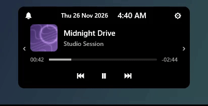

# wi-notch

wi-notch is a desktop overlay for Windows 11. It puts the clock, media controls, notifications, and timers in a notch at the top of your display. Hover over the notch to expand it.

> **Early development.** wi-notch is in alpha. Updates will come frequently, and features, settings, and behavior may change between builds.



## Download and run

1. Download the Windows x64 executable from [GitHub Releases](https://github.com/HexCore99/wi-notch/releases).
2. Open the downloaded `.exe`.
3. Hover over the clock. Use the side arrows to switch views, click the date to open the calendar, or click the gear for Settings.

The app runs directly from the downloaded file. Use Task Manager to end the wi-notch process if you need to close the overlay.

### Windows notifications

Click the bell to open the notification center. If wi-notch asks you to enable access, select **Enable Windows notifications** and approve the Windows prompt.

The portable notification listener was verified on Windows 11 26H2. Availability can vary by Windows build and privacy settings. wi-notch keeps notification text in memory. It uses a read-only lookup of Windows notification history to open specific notifications from supported browsers.

## Features

- **Clock and calendar.** See the time and date at a glance and click the date to browse months. [Calendar demo](docs/demos/calendar.mp4)
- **Media controls and volume.** See album artwork and playback progress, control supported Windows media sessions, and see volume changes in the notch. [Music controls demo](docs/demos/music-controls.mp4) · [Volume demo](docs/demos/volume-hud.mp4)
- **Windows notifications.** See previews and an unread indicator, browse recent notifications, and open the source app from a notification. [Notification center demo](docs/demos/notification-center.mp4)
- **Pomodoro.** Run 25-minute focus sessions with 5-minute breaks and a 15-minute break after every fourth round. End-of-phase prompts wait for you to choose what happens next. Change the optional 30-second repeat chime in **Settings → Pomodoro**. [Pomodoro reminder demo](docs/demos/pomodoro-reminder.mp4)
- **Prayer times.** Search for a city offline, see a countdown to the next prayer, and enable reminders before or at the start of prayer. Dhaka is the default. Times use the Karachi method and Hanafi Asr. [Prayer times demo](docs/demos/prayer-times.mp4) · [Prayer reminders demo](docs/demos/prayer-reminders.mp4)
- **Appearance and placement.** Choose a display, adjust the notch's vertical position, customize its color and corners, or use a minimal layout. [Display settings demo](docs/demos/display-settings.mp4) · [Minimal modes demo](docs/demos/minimal-modes.mp4)

Settings are saved locally in `%LOCALAPPDATA%\wi-notch\settings.json`.

## Build from source

Use the stable x64 MSVC Rust toolchain, Visual Studio C++ build tools, and the Windows SDK. [Rust on Windows prerequisites](https://rust-lang.github.io/rustup/installation/windows-msvc.html)

```powershell
git clone https://github.com/HexCore99/wi-notch.git
cd wi-notch
cargo run --locked
cargo test --locked
```

The application is built with Rust and GPUI. The development package is available for testing package registration and notification access. [GPUI documentation](https://docs.rs/gpui/0.2.2/gpui/) · [Development packaging guide](packaging/README.md)

## Feedback

If you encounter a problem, include the wi-notch version, your Windows version, and steps to reproduce it. [GitHub Issues](https://github.com/HexCore99/wi-notch/issues)

## Credits

- The bundled city data adapts the GeoNames `cities15000`, `admin1CodesASCII`, and `countryInfo` datasets. [GeoNames downloads](https://download.geonames.org/export/dump/) · [CC BY 4.0](https://creativecommons.org/licenses/by/4.0/)
- Selected icons come from Bootstrap Icons. [Icon license](assets/icons/LICENSE)
